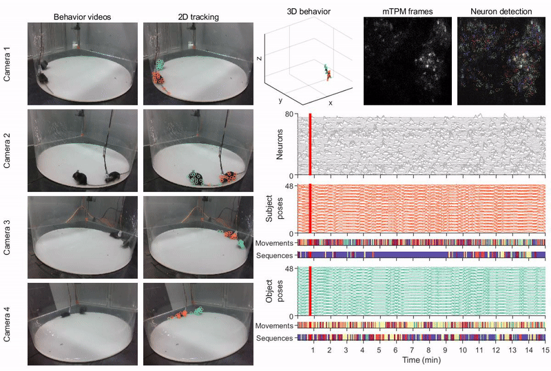
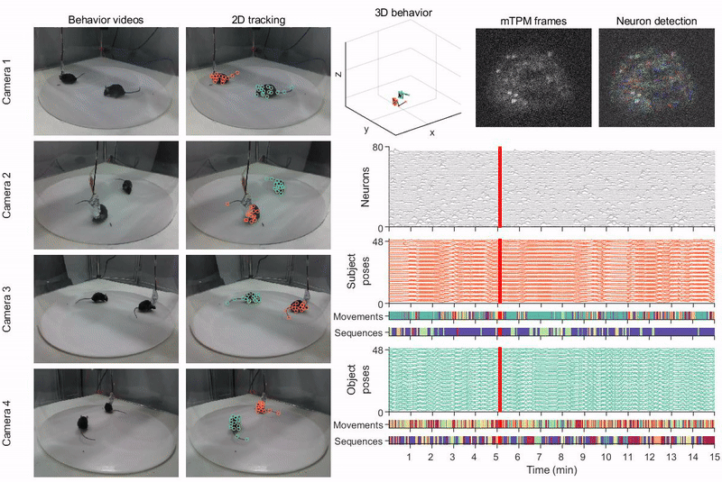
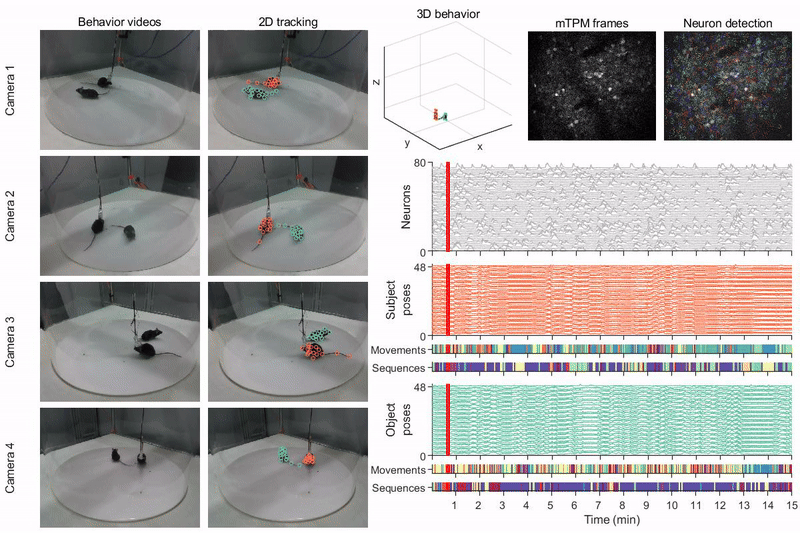
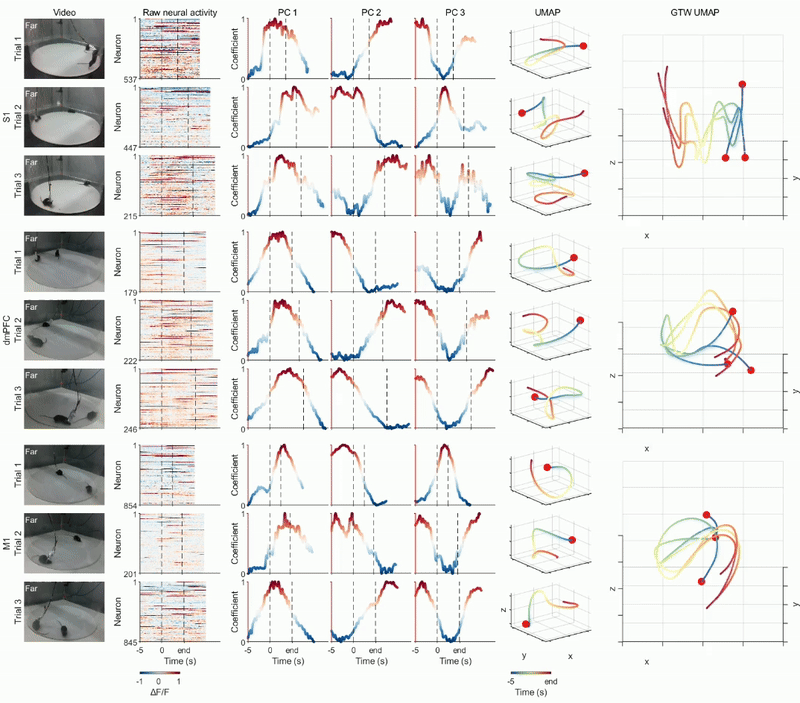
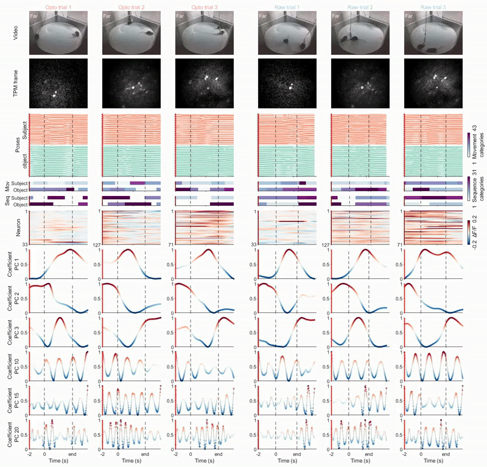

# behavior_timescales

Analysis and modeling code accompanying **Distributed cortical dynamics organize behavior across timescales**.

This repository contains MATLAB analyses, Python models, and visualizations for studying how cortical population dynamics relate to natural behavior at different temporal scales. The study combines miniature two-photon calcium imaging with synchronized multi-view recordings of freely interacting mice, comparing the primary somatosensory cortex (S1), dorsomedial prefrontal cortex (dmPFC), and primary motor cortex (M1).

## Scientific overview

Behavior is quantified as continuous **3D poses**, discrete **movement motifs**, and temporally extended **behavioral sequences**, using Anti-Drift Pose Tracker (ADPT), Behavior Atlas (BeA), and BL-BERT-derived sequence labels. These representations relate short-timescale kinematic details and longer-timescale behavioral structure to the same ongoing neural activity.

The analyses address four main findings of the accompanying manuscript:

- **Episode-specific dynamics:** full-session neural trajectories vary continuously, while repeated social interaction episodes reveal reproducible population dynamics across S1, dmPFC, and M1.
- **Dimensional organization across timescales:** leading neural principal components preferentially represent longer-timescale behavioral structure, while higher-order components contribute to shorter-timescale postural details. Cortical regions differ in their weighting of these dimensions, with dmPFC more strongly weighted toward lower-dimensional representations and S1 and M1 toward higher-dimensional features.
- **Selective effects of cortical perturbation:** optogenetic perturbation of dmPFC constrains high-dimensional dynamics and reduces fine-scale behavioral details, while lower-dimensional trajectory structure remains comparatively preserved.
- **Organization across behavioral contexts:** social interaction, re-engagement, and disengagement are associated with distinct episode-specific dynamics, extending the analysis beyond a single type of behavioral event.

Supporting analyses include single-neuron encoding, CEBRA neural-behavioral embeddings, recurrent switching linear dynamical systems (rSLDS), and the Neural PC-aligned Encoder–Decoder Reservoir Network (NPC-EDREN). NPC-EDREN models the transformation from partner-mouse poses through neural principal components to subject-mouse poses, including shuffled-input controls and simulated perturbations.

## Repository contents

```text
behavior_timescales/
├── README.md
├── LICENSE
├── demo/                       # GIF visualizations
├── matlab/
│   ├── min_demo_reproduce_lmt.m # Introductory social-episode analysis
│   ├── process_steps/          # Preprocessing and analysis scripts
│   ├── function/               # Helper functions and bundled toolboxes
│   └── figs/                   # Figure-generation scripts and helpers
└── python/
    ├── bl_bert/                # CEBRA embedding and decoding analyses
    ├── rslds/                  # rSLDS fitting and perturbation analyses
    └── npc_edren/              # Reservoir models, controls, and perturbations
```

Some filenames retain historical terminology, including `min_demo_reproduce_lmt.m`. The scientific description here follows the accompanying manuscript. Figure-script filenames also retain development numbering; match them to manuscript panels by their analysis content.

| Component | Contents and entry points |
| --- | --- |
| Introductory MATLAB analysis | `matlab/min_demo_reproduce_lmt.m`: loads synchronized data, extracts social interaction episodes, aligns movement and sequence labels, and visualizes neural principal components. |
| Preprocessing and behavioral analysis | `matlab/process_steps/`: 2D pose merging, 3D reconstruction, BeA processing, neural-behavioral synchronization, resampling and filtering, sequence matching, episode extraction, linear fitting, DTAK clustering, and GTW alignment. |
| Figure generation | `matlab/figs/`: `fig*.m` and `SM_fig*.m` scripts for main and supplementary analyses, with supporting code. |
| Neural-behavioral embeddings | `python/bl_bert/`: `self_*` and `partner_*` scripts fit CEBRA embeddings for poses, movements, and sequences; `*_reconstruction.py` scripts evaluate decoding. Despite its historical folder name, this directory contains CEBRA analyses rather than a standalone BL-BERT training implementation. |
| Latent dynamical models | `python/rslds/`: `ssm_test_my_data_cut*.py` scripts analyze latent dynamics; `ssm_rec_op_social_spl_pc_20251009.py` analyzes recording and perturbation conditions. |
| Neural PC-aligned reservoir models | `python/npc_edren/`: `reservoir_pca_align_complex.py` implements the encoder–decoder model; companion scripts analyze reservoir states, shuffled controls, and simulated perturbations. `reservoir_pca_align_complex_state_op_acti_homeo.py` includes activity-dependent adaptation. |

## Data access

Data are distributed separately from the code. The following archives are listed in the accompanying manuscript and the original repository documentation:

| Dataset | Archive |
| --- | --- |
| Neuroethology reproduction data, model outputs, and demonstration recordings | [Figshare 30773648](https://doi.org/10.6084/m9.figshare.30773648) |
| Processed neural and behavioral data for analysis | [Figshare 30781931](https://doi.org/10.6084/m9.figshare.30781931) |
| Raw S1 mTPM recordings and neural trajectories, mice 1–5 | [Figshare 30771338](https://doi.org/10.6084/m9.figshare.30771338) |
| Raw dmPFC mTPM recordings and neural trajectories, mice 1–5 | [Figshare 30772454](https://doi.org/10.6084/m9.figshare.30772454) |
| Raw M1 mTPM recordings and neural trajectories, mice 1–5 | [Figshare 30772685](https://doi.org/10.6084/m9.figshare.30772685) |
| Raw dmPFC mTPM recordings and neural trajectories, mice 6–10 | [Figshare 30772766](https://doi.org/10.6084/m9.figshare.30772766) |
| Raw dmPFC mTPM recordings and neural trajectories under optogenetic perturbation, mice 6–10 | [Figshare 30773072](https://doi.org/10.6084/m9.figshare.30773072) |

Start with the processed analysis data for the introductory MATLAB analysis. Raw imaging and video data are needed when repeating preprocessing from the original recordings.

The reproduction archive is described as containing ADPT pose predictions, BeA movement decompositions, BL-BERT sequence outputs, camera calibration, example videos, NPC-EDREN states, and synchronization files. Use the archive's own file listing to locate the inputs required by a particular script.

## Recording identifiers and data format

Files belonging to the same recording share a base identifier:

```text
condition-recording-subject-partner-date
```

For example, `free-seg2-2tpmm-rwt-20231108-neu.mat` contains the condition, recording segment, subject mouse, partner mouse, recording date, and data-type suffix. Further suffixes identify the animal role or analysis output.

The **subject** is the mouse carrying the miniature two-photon microscope; the **partner** (called the “object mouse” in the manuscript) is the unimplanted mouse. Behavioral suffixes `tpm` and `free` denote subject and partner, respectively. Within subject identifiers, `tpmss`, `tpmpfc`, and `tpmm` denote S1, dmPFC, and M1 recordings.

| File suffix | MATLAB variable | Contents |
| --- | --- | --- |
| `-neu.mat` | `dff_smo_Fc` | Preprocessed neural activity; MATLAB loading scripts transpose this array. |
| `-pose-tpm.mat`, `-pose-free.mat` | `coords3d` | Subject or partner 3D poses. |
| `-beh_mod-tpm.mat`, `-beh_mod-free.mat` | `beh_mod_list` | Subject or partner movement labels. |
| `-seq-tpm.mat`, `-seq-free.mat` | `seq_label_list` | Subject or partner sequence labels. |
| `-distance-free.mat` | `dist_data` | Inter-animal distance information and proximity labels used for episode extraction. |

Model and embedding outputs append additional suffixes, such as `-cebra.mat` or `-cut-rnn_ed_train_2layers.mat`. Each downstream script specifies the outputs it expects.

A recording can be inspected with the following MATLAB example:

```matlab
% Set this to the folder containing the extracted processed MAT files.
data_dir = 'D:\data\neuroethology_for_analysis';
recordings = dir(fullfile(data_dir, 'free*-neu.mat'));
assert(~isempty(recordings), 'No free*-neu.mat files found in data_dir.');

base_id = erase(recordings(1).name, '-neu.mat');
neural = load(fullfile(data_dir, recordings(1).name));
subject_pose = load(fullfile(data_dir, [base_id, '-pose-tpm.mat']));
partner_pose = load(fullfile(data_dir, [base_id, '-pose-free.mat']));
subject_movements = load(fullfile(data_dir, [base_id, '-beh_mod-tpm.mat']));
subject_sequences = load(fullfile(data_dir, [base_id, '-seq-tpm.mat']));
distance = load(fullfile(data_dir, [base_id, '-distance-free.mat']));

neural_activity = neural.dff_smo_Fc';
subject_coords = subject_pose.coords3d;
partner_coords = partner_pose.coords3d;
```

## Environment and dependencies

The earlier repository documentation specified MATLAB R2023a or later and Python 3.10 or later. Exact tested package versions are not recorded in this checkout; these version statements are starting points for setup rather than a verified compatibility matrix.

For the introductory MATLAB script, install **Statistics and Machine Learning Toolbox** (`pca`) and **Image Processing Toolbox** (`mat2gray`). Additional analyses can require Signal Processing Toolbox, Optimization Toolbox, Predictive Maintenance Toolbox, and Deep Learning Toolbox, depending on the functions used. Bundled BeA, GTW, and other helper code is under `matlab/function/` and `matlab/figs/function/`; some bundled MEX binaries are platform-specific.

Python dependencies depend on the selected module:

| Module | Imported packages |
| --- | --- |
| CEBRA analyses (`python/bl_bert/`) | `cebra`, `torch`, `numpy`, `scipy`, `matplotlib`, `h5py`, `joblib`, `tqdm` |
| rSLDS (`python/rslds/`) | `ssm`, `autograd`, `numpy`, `scipy`, `scikit-learn`, `matplotlib`, `seaborn`, `tqdm` |
| NPC-EDREN (`python/npc_edren/`) | `brainpy`, `brainpy_datasets`, `jax`, `numpy`, `scipy`, `scikit-learn`, `matplotlib`, `tqdm` |

Use the installation instructions for [CEBRA](https://cebra.ai/docs/), [the Linderman lab's `ssm`](https://github.com/lindermanlab/ssm), and [BrainPy](https://github.com/brainpy/BrainPy) when setting up the corresponding module. The CEBRA training scripts select `device='cuda'`, so their current configuration requires a CUDA-capable PyTorch environment. Reservoir scripts select their computational platform within the script. Record the versions used for any reproduced analysis.

## Getting started

1. Download and extract the processed analysis data. Confirm that matching neural, pose, movement, sequence, and distance files are available for each selected recording.
2. Open `matlab/min_demo_reproduce_lmt.m`. In its path-configuration section, set `rootpath` to your local data location and set `beh_neu_path` to the folder containing the processed MAT files. Review the historical `rmpath` entries for your local setup.
3. Set MATLAB's current folder to the repository's `matlab/` directory so that the script's `addpath(genpath(pwd))` includes its helpers, then run:

   ```matlab
   min_demo_reproduce_lmt
   ```

4. Inspect the episode-aligned movement and sequence visualization and the neural-PC plots. The script uses a 30 Hz analysis timebase, selecting proximity-defined interaction periods of 2–10 seconds with 5-second flanking periods.
5. For additional analyses, select a preprocessing, modeling, or figure script and configure its input and output paths. Python scripts likewise contain `rootpath`, `beh_neu_path`, or `savepath` settings that must point to your data and output folders.

The introductory script illustrates social-episode extraction and PCA analysis. Reproducing all manuscript results additionally requires the relevant model outputs, recording conditions, and figure scripts. Runtime depends on the selected data and analysis; full reproduction has not been benchmarked here.

Many scripts retain laboratory-specific Windows drive paths or Linux paths, and some use historical data-folder names such as `beh_neu_20240412` and `beh_neu_20250918`. Configure paths within each selected script before running it. Processed-data analyses can be run independently of raw-data preprocessing when their required inputs are already available.

## Demonstrations

These GIFs provide visual examples of the recordings and analyses. Filenames retain the numbering of the earlier code version.

### Naturalistic neural and behavioral recordings

MouseVenue3D combines multi-view behavioral recordings with miniature two-photon imaging. The examples below show recordings from the three cortical areas.

**S1**



**dmPFC**



**M1**



### Neural population dynamics during social interaction

Population-level representations reveal temporal structure associated with social interaction episodes, complementing heterogeneous single-neuron responses.



### Neural and behavioral responses to optogenetic perturbation

The accompanying analyses compare neural activity, population dynamics, and behavior between recording and perturbation conditions. In the manuscript, perturbation preferentially constrains high-dimensional dynamics and reduces short-timescale behavioral details, while lower-dimensional structure remains comparatively preserved.



### Neural PC-aligned encoder–decoder reservoir model

NPC-EDREN links partner poses, neural principal components, and subject poses through recurrent reservoir representations. Supporting scripts evaluate prediction, internal dynamics, shuffled-input controls, and simulated perturbations.


## Related software

- [ADPT](https://github.com/tangguoling/ADPT): pose estimation and associated tools.
- [Behavior Atlas](https://github.com/huangkang314/Behavior-Atlas): hierarchical behavioral decomposition.
- [Social Behavior Atlas](https://github.com/YNCris/SBeA_release): multi-animal social behavior analysis.
- [MouseVenue3D](https://github.com/YNCris/natural_behavior_device): behavioral recording apparatus and acquisition tools.
- [CEBRA](https://cebra.ai/docs/): neural-behavioral embedding and decoding.
- [rSLDS / ssm](https://github.com/lindermanlab/ssm): switching dynamical-system inference.
- [BrainPy](https://github.com/brainpy/BrainPy): reservoir-network implementation.

## Citation

If you use these analyses, please cite the accompanying manuscript:

> Han, Y., Liu, Q., Liu, S., Cheng, H., and Wei, P. **Distributed cortical dynamics organize behavior across timescales.**

Please also cite the relevant methods and software used in your analysis.

## References

[1] [Huang, K., Han, Y., Chen, K., Pan, H., Zhao, G., Yi, W., ... & Wang, L. (2021). A hierarchical 3D-motion learning framework for animal spontaneous behavior mapping. Nature communications, 12(1), 2784.](https://www.nature.com/articles/s41467-021-22970-y)  
[2] [Han, Y., Chen, K., Wang, Y., Liu, W., Wang, Z., Wang, X., ... & Wei, P. (2024). Multi-animal 3D social pose estimation, identification and behaviour embedding with a few-shot learning framework. Nature machine intelligence, 6(1), 48-61.](https://www.nature.com/articles/s42256-023-00776-5)  
[3] [Han, Y., Huang, K., Chen, K., Pan, H., Ju, F., Long, Y., ... & Wei, P. (2022). MouseVenue3D: A markerless three-dimension behavioral tracking system for matching two-photon brain imaging in free-moving mice. Neuroscience Bulletin, 38(3), 303-317.](https://link.springer.com/article/10.1007/s12264-021-00778-6)  
[4] [Tang, G., Han, Y., Sun, X., Zhang, R., Han, M. H., Liu, Q., & Wei, P. (2025). Anti-drift pose tracker (ADPT), a transformer-based network for robust animal pose estimation cross-species. Elife, 13, RP95709.](https://elifesciences.org/articles/95709)  
[5] [Han, Y., Jiang, Z., Ju, F., Wang, L., Liu, Q., & Wei, P. (2024, August). BL-BERT: Extracting Body Language from Behavior Sequences in Freely Moving Mice. In International Workshop on Human Brain and Artificial Intelligence (pp. 181-191). Singapore: Springer Nature Singapore.](https://link.springer.com/chapter/10.1007/978-981-96-4001-0_12)  
[6] [Han, Y., & Wei, P. (2025). Decoding Natural Behavior from Neuroethological Embedding. Journal of visualized experiments: JoVE, (224).](https://app.jove.com/t/68668/decoding-natural-behavior-from-neuroethological-embedding)  
[7] [Linderman, S., Johnson, M., Miller, A., Adams, R., Blei, D., & Paninski, L. (2017, April). Bayesian learning and inference in recurrent switching linear dynamical systems. In Artificial intelligence and statistics (pp. 914-922). PMLR.](https://proceedings.mlr.press/v54/linderman17a.html)  
[8] [Wang, C., Zhang, T., Chen, X., He, S., Li, S., & Wu, S. (2023). BrainPy, a flexible, integrative, efficient, and extensible framework for general-purpose brain dynamics programming. elife, 12, e86365.](https://elifesciences.org/articles/86365)  
[9] [Zong, W., Wu, R., Li, M., Hu, Y., Li, Y., Li, J., ... & Cheng, H. (2017). Fast high-resolution miniature two-photon microscopy for brain imaging in freely behaving mice. Nature methods, 14(7), 713-719.](https://www.nature.com/articles/nmeth.4305)  
[10] [Zong, W., Wu, R., Chen, S., Wu, J., Wang, H., Zhao, Z., ... & Cheng, H. (2021). Miniature two-photon microscopy for enlarged field-of-view, multi-plane and long-term brain imaging. Nature methods, 18(1), 46-49.](https://www.nature.com/articles/s41592-020-01024-z)
[11] [Schneider, S., Lee, J. H., & Mathis, M. W. (2023). Learnable latent embeddings for joint behavioural and neural analysis. Nature, 617, 360–368.](https://doi.org/10.1038/s41586-023-06031-6)

## License and support

Repository code is distributed under the [MIT License](LICENSE). Bundled third-party components retain their respective license terms and notices. Dataset reuse is governed by the terms of the corresponding data archives.

For questions or bug reports, open an issue in the repository where you obtained this code. Include the script name, recording identifier, environment versions, and error message or unexpected output.
